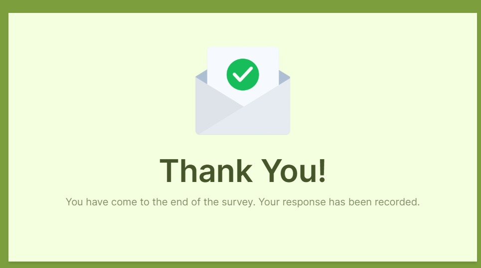

# TheLook Ecommerce Analysis SQL

## Tujuan

- Untuk mengetahui penjualan dari TheLook Ecommerce

## Dataset

**Data Source** : TheLookEcommerce BigQuery

## Pertanyaan 

### 1. Berapa jumlah order dengan status Complete ?

Jumlah order dengan status Complete yang tercatat adalah 80.000 order.

### 2. .......

## Key Takeaways

- Ada 80.000 order yang Complete
- .....
- ...
  
